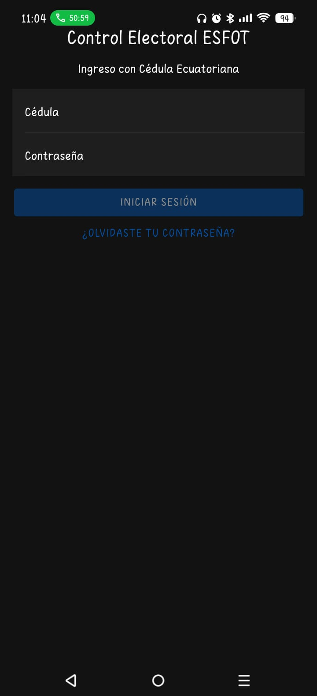
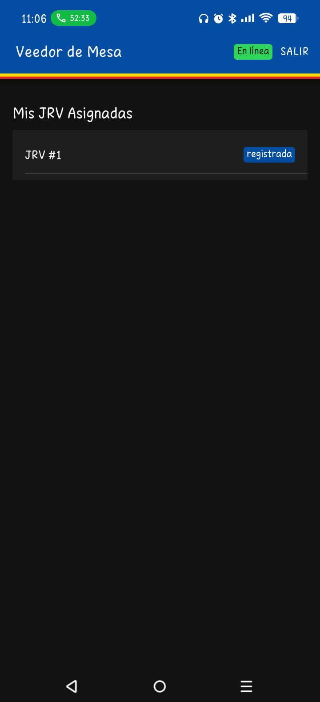

# Sistema de Gestión de Juntas Receptoras del Voto

Aplicación móvil híbrida para la gestión y supervisión del registro de actas de las Juntas Receptoras del Voto (JRV). El sistema organiza el trabajo de los coordinadores provinciales, coordinadores de recinto y veedores, y permite registrar resultados electorales con evidencia fotográfica y ubicación GPS.

El proyecto está desarrollado con Ionic, Angular y Capacitor. Supabase se utiliza como servicio de autenticación, base de datos y almacenamiento de fotografías. Además, incorpora mecanismos para conservar registros pendientes cuando el dispositivo pierde la conexión y sincronizarlos cuando vuelve a estar en línea.

---

## Contenido

- [Descripción general](#descripción-general)
- [Funcionalidades](#funcionalidades)
- [Roles del sistema](#roles-del-sistema)
- [Tecnologías utilizadas](#tecnologías-utilizadas)
- [Arquitectura del proyecto](#arquitectura-del-proyecto)
- [Flujo de registro de un acta](#flujo-de-registro-de-un-acta)
- [Requisitos previos](#requisitos-previos)
- [Instalación y ejecución](#instalación-y-ejecución)
- [Configuración de Supabase](#configuración-de-supabase)
- [Generación de la aplicación Android](#generación-de-la-aplicación-android)
- [Evidencias de funcionamiento](#evidencias-de-funcionamiento)
- [Video de presentación](#video-de-presentación)
- [Validaciones y consideraciones](#validaciones-y-consideraciones)
- [Autoría](#autoría)

---

## Descripción general

El sistema permite administrar la estructura operativa de las Juntas Receptoras del Voto y dar seguimiento al registro de actas electorales. La información se organiza por provincia, recinto y mesa. Cada usuario accede a las opciones correspondientes a su rol.

Los veedores registran los resultados de las dignidades disponibles, adjuntan una fotografía del acta y capturan las coordenadas GPS. Los coordinadores de recinto pueden administrar veedores, asignarlos a mesas y revisar o corregir actas. El coordinador provincial administra los recintos y coordinadores de recinto, además de consultar resultados consolidados.

La aplicación contempla dos dignidades en el modelo de datos: alcalde y prefecto.

## Funcionalidades

### Autenticación y control de acceso

- Inicio de sesión mediante número de cédula y contraseña.
- Consulta del correo asociado a la cédula mediante una función RPC de Supabase.
- Carga del perfil y del rol del usuario autenticado.
- Redirección a la interfaz correspondiente según el rol.
- Recuperación de contraseña mediante correo electrónico.
- Cambio obligatorio de contraseña cuando el perfil lo requiere.
- Cierre de sesión.
- Protección de rutas mediante un guard que verifica sesión, rol y cambio obligatorio de contraseña.

### Gestión provincial

- Consulta de información de recintos, mesas, candidatos y actas.
- Registro de recintos con provincia, cantón, parroquia, nombre y cantidad de JRV.
- Generación de las mesas asociadas al recinto al momento de crearlo.
- Registro de coordinadores de recinto.
- Consulta de resultados consolidados por dignidad.
- Filtro de resultados por recinto.
- Visualización de votos por organización, votos blancos y votos nulos, junto con el número de actas procesadas y mesas consideradas.

### Gestión del recinto

- Consulta de las JRV pertenecientes al recinto asignado al coordinador.
- Registro de veedores.
- Asignación de veedores a las mesas.
- Consulta de actas registradas en el recinto.
- Revisión de la información asociada al registro.
- Corrección de los valores de un acta y actualización de su estado.

### Registro de actas por parte del veedor

- Visualización de las mesas asignadas al usuario.
- Selección de la JRV y de la dignidad que se va a registrar.
- Ingreso de votos para las cinco organizaciones contempladas en el modelo, votos blancos, votos nulos y total de sufragantes.
- Validación de los datos antes de guardar el acta.
- Captura de fotografía desde la cámara del dispositivo.
- Comprobación básica de nitidez de la fotografía antes de aceptarla.
- Captura de latitud y longitud mediante GPS.
- Envío del acta y de su evidencia a Supabase cuando existe conexión.
- Almacenamiento temporal de registros pendientes cuando no hay conexión, para su posterior sincronización.

### Operación sin conexión y sincronización

El servicio `OfflineSyncService` supervisa el estado de conectividad mediante Capacitor Network. Cuando no existe conexión, los registros se incorporan a una cola local:

- En Android, la cola se almacena mediante SQLite.
- En ejecución web, se utiliza `localStorage` como alternativa.
- Al detectarse nuevamente una conexión, se inicia el proceso de sincronización.
- Las fotografías pendientes se cargan en el almacenamiento de Supabase y luego se actualiza el registro del acta.
- Se contempla una comprobación para evitar que un registro pendiente del veedor sobrescriba una corrección realizada por el coordinador de recinto.

## Roles del sistema

| Rol | Responsabilidades |
|---|---|
| Coordinador provincial | Registrar recintos y coordinadores de recinto; consultar información general y resultados consolidados. |
| Coordinador de recinto | Administrar veedores, asignarlos a las JRV del recinto, revisar actas y corregir registros. |
| Veedor | Consultar las mesas asignadas y registrar actas con fotografía y ubicación GPS. |

El acceso a las pantallas está restringido mediante rutas protegidas y validación del rol almacenado en el perfil del usuario.

## Tecnologías utilizadas

| Tecnología | Aplicación en el proyecto |
|---|---|
| Ionic Framework 9 | Componentes de interfaz y estructura visual de la aplicación móvil. |
| Angular 22 | Componentes, navegación, servicios, formularios y lógica de la aplicación. |
| TypeScript 6 | Implementación de la lógica y los modelos de datos. |
| Capacitor 8 | Integración de la aplicación web con las capacidades nativas de Android. |
| Supabase | Autenticación, consultas, persistencia de datos, funciones RPC y almacenamiento de fotografías. |
| Supabase JS 2 | Cliente JavaScript para comunicarse con los servicios de Supabase. |
| SQLite | Persistencia local de la cola de actas pendientes en dispositivos nativos. |
| RxJS 7 | Manejo de flujos de estado y cambios de conectividad. |
| Ionicons 8 | Iconografía de la interfaz. |
| HTML y SCSS | Estructura y estilos de las pantallas. |
| Node.js y npm | Entorno de ejecución y administración de dependencias. |
| Android Studio y Gradle | Compilación, ejecución y generación de la aplicación Android. |

### Plugins y librerías de Capacitor

- `@capacitor/camera`: captura de fotografías desde la cámara.
- `@capacitor/geolocation`: obtención de coordenadas GPS.
- `@capacitor/network`: consulta y seguimiento del estado de conexión.
- `@capacitor-community/sqlite`: almacenamiento local de registros pendientes.
- `@capacitor/android`: plataforma Android.
- `@capacitor/app`, `@capacitor/haptics`, `@capacitor/keyboard` y `@capacitor/status-bar`: integración con funcionalidades del dispositivo.

### Herramientas de calidad y pruebas

El proyecto incluye configuración para:

- **ESLint y angular-eslint:** análisis estático del código.
- **Prettier:** mantenimiento de un formato consistente.
- **Vitest:** pruebas unitarias.
- **Playwright:** pruebas de extremo a extremo.

## Arquitectura del proyecto

La aplicación organiza la lógica en páginas, servicios, modelos, validadores y mecanismos de protección de rutas.

```text
src/
├── app/
│   ├── guards/
│   │   └── role.guard.ts
│   ├── home/
│   ├── models/
│   │   └── electoral.model.ts
│   ├── pages/
│   │   ├── cambiar-clave/
│   │   ├── login/
│   │   ├── provincial/
│   │   ├── recinto/
│   │   └── veedor/
│   ├── services/
│   │   ├── auth.service.ts
│   │   ├── camera-gps.service.ts
│   │   ├── electoral.service.ts
│   │   ├── offline-sync.service.ts
│   │   └── supabase.service.ts
│   ├── validators/
│   ├── app.component.*
│   └── app.routes.ts
├── assets/
├── environments/
├── global.scss
├── index.html
└── main.ts

android/                 # Proyecto nativo Android generado con Capacitor
assets/                  # Recursos gráficos de la aplicación
docs/
└── Evidencia/           # Capturas de las funcionalidades
```

### Responsabilidad de los principales servicios

| Servicio | Responsabilidad |
|---|---|
| `AuthService` | Inicio y cierre de sesión, recuperación y cambio de contraseña, y creación de usuarios mediante una función de Supabase. |
| `SupabaseService` | Inicialización y exposición del cliente de Supabase. |
| `ElectoralService` | Consulta y administración de recintos, JRV, candidatos, perfiles y actas. |
| `CameraGpsService` | Captura de fotografías, comprobación básica de nitidez y obtención de coordenadas GPS. |
| `OfflineSyncService` | Detección de conectividad, almacenamiento local de actas pendientes y sincronización posterior. |

Los modelos principales se encuentran en `electoral.model.ts`. Allí se definen las estructuras de perfil, recinto, JRV, candidato y acta.

## Flujo de registro de un acta

1. El veedor inicia sesión con su cédula y contraseña.
2. El sistema identifica su perfil y muestra las JRV que tiene asignadas.
3. El veedor selecciona una mesa y la dignidad correspondiente.
4. Ingresa los votos y el total de sufragantes.
5. La aplicación valida los valores ingresados mediante los validadores del formulario.
6. El veedor captura la fotografía del acta. La aplicación realiza una comprobación básica de nitidez.
7. Se obtiene la ubicación GPS del dispositivo.
8. Si existe conexión, la fotografía se carga en Supabase Storage y el acta se registra en la base de datos.
9. Si no existe conexión, la información se almacena en la cola local para intentar sincronizarla posteriormente.
10. El coordinador de recinto puede revisar el registro y, cuando corresponda, corregirlo.

## Requisitos previos

Para ejecutar el proyecto se necesita:

- Node.js y npm.
- Un editor de código, como Visual Studio Code.
- Una cuenta y un proyecto configurado en Supabase.
- Android Studio y el SDK de Android, si se desea compilar para Android.
- Un dispositivo o emulador Android para probar las funciones nativas de cámara, GPS y SQLite.

Las versiones principales declaradas por el proyecto son Angular 22, Ionic 9, Capacitor 8 y TypeScript 6. Se recomienda utilizar una versión de Node.js compatible con Angular CLI 22.

## Instalación y ejecución

### 1. Clonar el repositorio

```bash
git clone https://github.com/MaCaReNo26/JuntasReceptoras-by-Alex.git
cd JuntasReceptoras-by-Alex
```

### 2. Instalar dependencias

```bash
npm install
```

### 3. Configurar las credenciales de Supabase

Revisar los archivos de entorno:

```text
src/environments/environment.ts
src/environments/environment.prod.ts
```

Configurar la URL del proyecto y la clave pública correspondiente:

```typescript
export const environment = {
  production: false,
  supabase: {
    url: 'https://TU-PROYECTO.supabase.co',
    anonKey: 'TU_CLAVE_PUBLICA'
  }
};
```

Utilizar los valores correspondientes al proyecto de Supabase. No se debe incluir una clave `service_role` en una aplicación cliente ni publicar credenciales privadas.

### 4. Ejecutar en desarrollo

```bash
npm start
```

El servidor de desarrollo de Angular estará disponible normalmente en:

```text
http://localhost:4200
```

También se puede utilizar:

```bash
npx ionic serve
```

### 5. Compilar el proyecto web

```bash
npm run build
```

## Configuración de Supabase

La aplicación utiliza Supabase como backend. Para reproducir el entorno se debe configurar el proyecto y disponer de los recursos que consume el código.

Entre los elementos identificados en la implementación se encuentran:

- Tabla `perfiles`, para los datos de usuario y su rol.
- Tabla `recintos`, para la información de los recintos electorales.
- Tabla `jrv`, para las Juntas Receptoras del Voto y su estado.
- Tabla `candidatos`, para las organizaciones y candidatos por dignidad.
- Tabla `actas`, para los resultados, datos de ubicación y referencia de la fotografía.
- Bucket de Storage `actas`, para almacenar las fotografías.
- Función RPC `obtener_correo_por_cedula`, utilizada durante el inicio de sesión.
- Función Edge `crear-usuario`, invocada para crear usuarios de acuerdo con la jerarquía del sistema.

La estructura completa de la base de datos, las políticas RLS y el código de las funciones deben configurarse en el proyecto de Supabase. No se incluyen scripts SQL de creación de esquema en la estructura entregada junto con este README.

## Generación de la aplicación Android

El repositorio incluye el proyecto nativo Android administrado mediante Capacitor.

Después de instalar las dependencias y configurar Supabase, ejecutar:

```bash
npm run build
npx cap sync android
npx cap open android
```

Android Studio permitirá compilar y ejecutar la aplicación en un emulador o dispositivo conectado.

Para probar las funcionalidades nativas se deben conceder los permisos de cámara y ubicación solicitados por la aplicación. La persistencia SQLite de la cola offline se inicializa en plataformas nativas.

---

## Evidencias de funcionamiento

Las siguientes capturas muestran las principales pantallas y operaciones del sistema. Los archivos originales se encuentran en `docs/Evidencia/`.

### Acceso al sistema

<p align="center">
  
</p>

<p align="center"><sub>Inicio de sesión mediante cédula y contraseña.</sub></p>

### Gestión provincial y de recintos

<p align="center">
  
  &nbsp;&nbsp;&nbsp;
  
</p>

<p align="center"><sub>Registro de coordinadores y consulta de recintos.</sub></p>

### Registro de actas

<p align="center">
  
  &nbsp;&nbsp;&nbsp;
  
</p>

<p align="center"><sub>Panel del veedor y formulario de registro de resultados de una JRV.</sub></p>

### Consulta y corrección de actas

<p align="center">
  
  &nbsp;&nbsp;&nbsp;
  
</p>

<p align="center"><sub>Consulta de actas registradas y actualización de información.</sub></p>

### Resultados electorales

<p align="center">
  
  &nbsp;&nbsp;&nbsp;
  
</p>

<p align="center"><sub>Visualización de resultados y actas finales.</sub></p>

---

## Video de presentación

En el siguiente video se explica el funcionamiento del sistema, sus principales módulos y el proceso de trabajo de la aplicación.

[Ver video de presentación y explicación del proyecto en YouTube](https://youtu.be/WVZ57HevW14)

---

## Validaciones y consideraciones

- La cédula se valida mediante un validador propio del proyecto.
- Los formularios utilizan validaciones de campos obligatorios y restricciones numéricas.
- El formulario de actas utiliza `cuadraturaActaValidator` para comprobar la consistencia de los valores registrados.
- La fotografía se somete a una comprobación básica de nitidez antes de continuar.
- La captura de ubicación requiere permisos GPS.
- Las rutas de cada rol verifican que el usuario tenga un perfil válido y que haya completado el cambio obligatorio de contraseña cuando corresponda.
- La sincronización offline depende de que el dispositivo vuelva a tener conexión y de que los servicios de Supabase estén disponibles.

## APK

Se encuentra en el mismo repositorio el APK descargable para su funcionamiento. 

## Autoría

**Desarrollado por:** Alex Suarez

**Colaboradores:**
- Justin Paladines
- Sebastián Chico

**Repositorio:** [JuntasReceptoras-by-Alex](https://github.com/MaCaReNo26/JuntasReceptoras-by-Alex)

Proyecto de aplicación móvil para la gestión de Juntas Receptoras del Voto.
